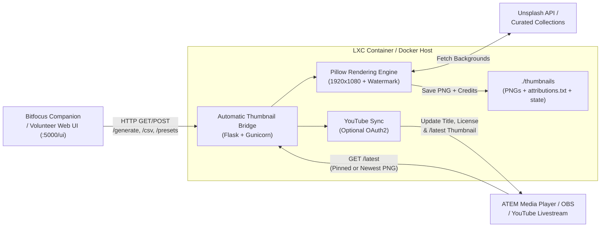

# Automatic Thumbnail

[](https://python.org)
[](https://www.proxmox.com)
[](https://www.docker.com)
[](https://systemd.io)
[](LICENSE)

REST HTTP service and CLI tool to generate branded `1920x1080` livestreaming thumbnails on demand from **Bitfocus Companion**, **Stream Deck**, **OBS**, or automated batch tasks — designed to run natively in a **Proxmox LXC**, **Docker**, or **Windows**.

---

## Architecture Overview



---

## Key Features

- **Bitfocus Companion & Stream Deck Ready**: Trigger thumbnail generation via simple `GET` or `POST` requests (`/generate`, `/<preset>/generate`, `/batch`), with plaintext `/is_busy` and `/is_ready` endpoints for live button feedback.
- **Livestreaming Presets**: Define reusable broadcast templates (`sabado`, `viernes`, `estudio`, etc.) in `config.json` and override `title`, `subtitle`, or `query` dynamically from Companion variables.
- **Live Asset Serving (`/latest` & `/thumbnails/<file>`)**: Point ATEM Media Player, OBS Image Sources, or Companion dynamic button previews directly to `http://<server-ip>:5000/latest` with `Cache-Control: no-store`. Any generated image can also be pinned as `/latest` from the Web UI or API.
- **Minimal Volunteer Web UI (`/ui` or `/`)**: Built-in browser interface for volunteers to trigger preset buttons, generate custom thumbnails, edit `miniaturas.csv` and run batch jobs, choose which image is `/latest`, and diagnose errors with a visual troubleshooting banner.
- **Optional YouTube Livestream Sync (`/youtube/*`)**: Pregenerates the livestream title (`[title] - [subtitle]`), updates only the `Miniatura:` / `Thumbnail:` license line in the bottom `Licencias:` list of the description, and uploads `/latest` as the YouTube livestream thumbnail.
- **Automatic YouTube Attributions**: Tracks Unsplash photographer credits in `attributions.txt` and exposes them via `GET /attributions`.
- **Dynamic Typography & Branding**: Auto-sizes and wraps titles/subtitles with soft drop shadows, dims backgrounds for contrast, and composites the right sidebar gradient watermark and logo.
- **LXC & Container First**: Includes a native systemd unit, automated Proxmox LXC installer, `update` hook, Docker Compose setup, and backward-compatible CLI (`python script.py miniaturas.csv`).

---

## Repository Structure

```text
automatic-thumbnail/
├── app.py                        # Core Flask REST API service & Web UI server
├── script.py                     # Rendering engine & CLI batch processor
├── youtube_service.py            # Optional YouTube Data API v3 livestream sync
├── templates/
│   └── index.html                # Minimal volunteer Web UI
├── config.template.json          # Service & preset template configuration
├── miniaturas.csv                # Sample batch CSV input
├── assets/                       # Watermark & logo PNG assets
├── segoe-ui-black.ttf            # Primary display font
├── segoe-ui-bold.ttf             # Fallback bold font
├── pyproject.toml                # PEP 621 package metadata & CLI entrypoints
├── requirements.txt              # Python dependencies
├── Dockerfile                    # Container image with HEALTHCHECK
├── docker-compose.yml            # Container orchestration with persistent volumes
├── .dockerignore                 # Build exclusion rules (secrets & outputs)
├── install-lxc.sh                # One-command Proxmox / Debian LXC installer
├── update.sh                     # Automated service updater (git pull + pip + restart)
├── automatic-thumbnail.service   # Systemd service unit definition
├── test_app.py                   # Automated test suite (API + rendering)
├── start.sh                      # Linux startup wrapper
├── start.bat                     # Windows startup script
├── LICENSE                       # GNU GPLv3 License
└── README.md                     # Documentation
```

---

## Setup & Configuration

1. Create `config.json` from the template:
   ```bash
   cp config.template.json config.json
   ```

2. Edit `config.json` with your website, optional Unsplash API key, optional YouTube OAuth paths, and livestreaming presets:
   ```json
   {
     "port": 5000,
     "output_dir": "./thumbnails",
     "attributions_file": "./thumbnails/attributions.txt",
     "default_website": "sagunto.adventista.es",
     "unsplash_access_key": "",
     "watermark_file": "assets/right_sidebar_watermark.png",
     "logo_file": "assets/logo_watermark_bold.png",
     "font_file": "",
     "youtube": {
       "client_secrets_file": "client_secrets.json",
       "token_file": "youtube_token.json",
       "default_broadcast_id": ""
     },
     "presets": [
       {
         "name": "sabado",
         "title": "Culto de Adoración",
         "subtitle": "Sábado en Directo",
         "query": "iglesia",
         "filename": "miniatura_sabado",
         "variations": 1
       }
     ]
   }
   ```

> Note: `config.json`, `.env`, `client_secrets.json`, and `youtube_token.json` are ignored by git to prevent leaking API keys or OAuth tokens. Environment variables (`PORT`, `OUTPUT_DIR`, `ATTRIBUTIONS_FILE`, `DEFAULT_WEBSITE`, `UNSPLASH_ACCESS_KEY`, `WATERMARK_FILE`, `LOGO_FILE`, `FONT_FILE`, `CONFIG_PATH`, `CSV_PATH`, `YOUTUBE_CLIENT_SECRETS`, `YOUTUBE_TOKEN_FILE`, `YOUTUBE_BROADCAST_ID`) override `config.json` values when set.

---

## Deployment Options

### Option A: Proxmox / Debian LXC (Recommended)

1. Clone or copy the repository inside your LXC container:
   ```bash
   git clone <REPO_URL> /opt/automatic-thumbnail
   cd /opt/automatic-thumbnail
   ```

2. Run the automated installer as root:
   ```bash
   sudo bash install-lxc.sh
   ```
   *The installer provisions dependencies, creates the Python venv, enables `automatic-thumbnail.service`, and links the service to the standard LXC `update` command.*

3. Edit `/opt/automatic-thumbnail/config.json` if needed and restart:
   ```bash
   nano /opt/automatic-thumbnail/config.json
   systemctl restart automatic-thumbnail.service
   ```

#### Updating the LXC Service

Run:
```bash
update
```
*(Or `/opt/automatic-thumbnail/update.sh`)* to pull the latest code, update Python dependencies, and restart `automatic-thumbnail.service`.

---

### Option B: Docker Compose

1. Start the container:
   ```bash
   cd automatic-thumbnail
   docker compose up -d --build
   ```

2. Verify:
   ```bash
   curl http://<server-ip>:5000/health
   ```

---

### Option C: Windows Native

1. Create a virtual environment and install dependencies:
   ```cmd
   python -m venv venv
   venv\Scripts\pip install -r requirements.txt
   ```

2. Start the HTTP service:
   ```cmd
   venv\Scripts\python app.py
   ```
   Or double-click `start.bat`.

3. **CLI Batch Mode** (optional, standalone):
   ```cmd
   venv\Scripts\python script.py miniaturas.csv
   ```

---

## Testing

Run the automated test suite:

```bash
venv/Scripts/python -m unittest test_app.py -v
```

The test suite (14 tests) validates:
- Health (`/health`) and status (`/status`, `/is_busy`, `/is_ready`) endpoints.
- Preset resolution, CRUD (`POST /presets`, `DELETE /presets/<name>`), and dynamic overrides (`/<preset>/generate`).
- Synchronous and asynchronous (`async=true`) `1920x1080` PNG generation.
- Safe asset serving (`/thumbnails`, `/latest`, `/attributions`, `DELETE`) with path traversal protection and `/latest` pinning (`POST /latest`).
- Batch CSV processing (`POST /batch`) and CSV management/execution (`GET|POST /csv`).
- Web UI serving (`GET /ui` and `GET /` content negotiation).
- YouTube livestream title/license formatting (`[title] - [subtitle]`, bottom `Miniatura:` license replacement) and `/youtube/preview` + `/youtube/update`.

---

## API Reference

### System & Status Endpoints

| Method | URL | Description |
| :--- | :--- | :--- |
| GET | `/ui` (or `/` in browser) | Minimal volunteer Web UI (presets, gallery, CSV editor, YouTube sync) |
| GET | `/` (non-HTML) or `/health` | Health check with service status, font/Unsplash readiness, and preset count |
| GET | `/status` | Current job state (`idle`, `generating`, `ready`, `error`), last file, and counters |
| GET | `/is_busy` | Plaintext `true` or `false` while rendering (ideal for Companion feedback) |
| GET | `/is_ready` | Plaintext `true` or `false` when idle and thumbnails are available |
| POST | `/reload` | Reload `config.json` presets without restarting |

### Generation & Preset Endpoints

| Action | Method | URL | Description |
| :--- | :--- | :--- | :--- |
| Generate | GET / POST | `/generate` | Render from `title`, `subtitle`, `query`, `filename`, `variations`, `async` |
| Preset Generate | GET / POST | `/<preset>/generate` | Render using a named preset (supports query/JSON overrides) |
| List Presets | GET | `/presets` | List all configured presets |
| Add / Update Preset | POST | `/presets` | Create or update a preset and save it to `config.json` |
| Delete Preset | DELETE | `/presets/<name>` | Remove a preset from `config.json` |
| Batch CSV | GET / POST | `/batch` | Process `csv_path` (default `miniaturas.csv`) or raw `csv_content` |
| Read CSV | GET | `/csv` | Read `miniaturas.csv` as JSON rows (`?format=raw` for raw CSV) |
| Save / Run CSV | POST / PUT | `/csv` | Save `rows` or `raw` CSV to disk (pass `run=true` & `async=true` to generate) |

### Asset & Attribution Endpoints

| Action | Method | URL | Description |
| :--- | :--- | :--- | :--- |
| List Thumbnails | GET | `/thumbnails` | List generated PNGs sorted newest-first (includes `is_latest` & metadata) |
| Get Thumbnail | GET | `/thumbnails/<filename>` | Serve a specific PNG (`image/png`) |
| Delete Thumbnail | DELETE | `/thumbnails/<filename>` | Remove a specific PNG |
| Latest Thumbnail | GET | `/latest` | Serve the active `/latest` PNG (`?format=json` for metadata) |
| Pin Latest Thumbnail | POST / PUT | `/latest` | Choose which existing PNG (`filename`) should be served at `/latest` |
| Attributions | GET | `/attributions` | Plaintext Unsplash credits (`?format=json` for JSON) |

### YouTube Livestream Endpoints (Optional)

| Action | Method | URL | Description |
| :--- | :--- | :--- | :--- |
| YouTube Status | GET | `/youtube/status` | Check OAuth libraries, `client_secrets.json`, and token status |
| Start OAuth | GET | `/youtube/auth/start` | Generate Google OAuth authorization URL |
| OAuth Callback | GET | `/youtube/auth/callback` | Exchange OAuth code and save `youtube_token.json` |
| List Broadcasts | GET | `/youtube/broadcasts` | List active and upcoming YouTube livestreams |
| Preview Metadata | GET / POST | `/youtube/preview` | Preview `[title] - [subtitle]` and updated `Miniatura:` license |
| Update Livestream | GET / POST | `/youtube/update` | Update broadcast title, bottom `Miniatura:` license, and `/latest` thumbnail |

---

## Web Interface (For Volunteers)

Open `http://<server-ip>:5000/` (or `http://<server-ip>:5000/ui`) in any browser on the local network:

1. **Active `/latest` Monitor**: Shows the image currently served at `/latest` for ATEM Media Player / OBS / YouTube, along with its title, subtitle, and photographer license.
2. **Presets & Quick Generate**:
   - Click **Generate** next to any preset (`sabado`, `viernes`, `estudio`, etc.) to render immediately.
   - Click **+ Add Preset** to create new presets and save them to `config.json`.
   - Use **Quick Generate** for one-off titles/subtitles.
3. **Gallery & Choosing `/latest`**:
   - After batch or multi-variation generation, browse all PNGs in **Generated Thumbnails** and click **Set as /latest** on the image you want to go live.
4. **Batch CSV Editor (`miniaturas.csv`)**:
   - Add, edit, or remove rows directly in the table, then click **Save CSV** or **Save & Run Batch**.
5. **Visual Troubleshooting**:
   - The header shows live **Connection** (`Online` / `Offline`) and **Job Status** (`Ready` / `Generating...` / `Last Job Error`) badges.
   - If any request fails (network unreachable, `file://` opened directly, HTTP error, or background render error), a red **Troubleshooting Banner** appears at the top with the exact endpoint, error message, actionable tip, and a **Test Connection** button.

---

## YouTube Livestream Sync (Optional)

You can pregenerate and push the livestream **title**, **thumbnail license**, and **`/latest` PNG** directly to YouTube:

1. **Create OAuth Credentials** in Google Cloud Console:
   - Enable **YouTube Data API v3**.
   - Create an **OAuth 2.0 Client ID** (Web application) with authorized redirect URI:
     ```text
     http://<server-ip>:5000/youtube/auth/callback
     ```
   - Download the JSON file and save it as `client_secrets.json` in the project directory (or set `YOUTUBE_CLIENT_SECRETS` / `youtube.client_secrets_file` in `config.json`).
2. **Authorize Once**:
   - Open the Web UI (`http://<server-ip>:5000/ui`), scroll to **YouTube Livestream Sync**, and click **Connect YouTube Account**.
3. **How Updates Work**:
   - **Title**: Formatted as `[title] - [subtitle]` from the active `/latest` thumbnail.
   - **Description**: Reads the existing livestream description and **only** updates the `Miniatura:` (or `Thumbnail:`) line inside the `Licencias:` / `Licenses:` list at the bottom, leaving all other credits and links intact.
   - **Thumbnail**: Uploads the active `/latest` PNG to the selected (or auto-detected upcoming/active) livestream.
   - **Companion Trigger**: You can also trigger this from a Bitfocus Companion button via `POST http://<server-ip>:5000/youtube/update`.

---

## Bitfocus Companion Setup

### 1. One-Button Preset Generation

1. Open Companion web UI at `http://<companion-ip>:8000`.
2. Under **Connections**, add **Generic HTTP Requests**.
3. Select an empty button:
   - Set button text to `Thumbnail\nSábado`.
   - Under **Press Actions**, add **generic-http: HTTP POST** (or **HTTP GET**).
   - Set URL:
     ```text
     http://$(custom:thumbnail_server_ip):5000/sabado/generate?async=true
     ```
4. Press the button to trigger generation in the background.

### 2. Live Busy / Ready Button Feedback

1. **Create Custom Variables**:
   - `thumbnail_busy` (default `false`)
   - `thumbnail_ready` (default `false`)

2. **Create Periodic Polling Trigger** (Interval: `2000 ms`):
   - Action 1: **generic-http: HTTP GET** ➔ `http://$(custom:thumbnail_server_ip):5000/is_busy` ➔ Store result as text in `custom:thumbnail_busy`.
   - Action 2: **generic-http: HTTP GET** ➔ `http://$(custom:thumbnail_server_ip):5000/is_ready` ➔ Store result as text in `custom:thumbnail_ready`.

3. **Add Button Feedbacks**:
   - When `custom:thumbnail_busy == true` ➔ Background **Amber/Yellow** (`#ffaa00`).
   - When `custom:thumbnail_ready == true` ➔ Background **Green** (`#00aa44`).

### 3. OBS / vMix Integration

Add a **Browser Source** or **Image Source** pointing to:
```text
http://<server-ip>:5000/latest
```
Every time a button in Companion generates a new thumbnail, `/latest` automatically serves the newest `1920x1080` PNG.
